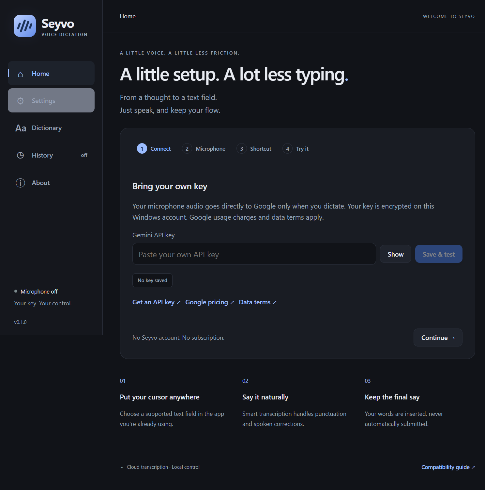

# Seyvo

**Speak. Refine. Paste.**

**A free, open-source alternative to the Wispr Flow workflow for Windows, powered by your own Gemini API key.**

Seyvo is a free-to-download, open-source Windows voice-dictation app under the [MIT license](LICENSE). Anyone can download and use it, including for commercial purposes. Bring your own Google Gemini API key, press a global shortcut, speak naturally, and insert finalized text into a supported application without submitting it.

Contributions are welcome from everyone. Read [CONTRIBUTING.md](CONTRIBUTING.md) and follow our [Code of Conduct](CODE_OF_CONDUCT.md) when participating.

**0.1.7 validation build:** fixes screenshot/browser clipboard paste, removes the box around the bubble, hides it after finishing, and correctly saves and reads Windows sign-in startup. Two consecutive generated-speech sessions passed through real Google and automatic Windows paste with exact text/HTML clipboard restoration. Source checks include 51 unit/integration tests and all 11 Electron scenarios in Windows CI. Physical microphone discovery/open/stop and installed restart checks also passed. The installer is unsigned; wider acceptance remains open. See the [release record](tests/manual-windows-qa.md).

[Download the Windows x64 installer](https://github.com/tirthankardgen-cell/Seyvo/releases/download/v0.1.7/Seyvo-0.1.7-windows-x64-setup.exe) · [SHA256 checksums](https://github.com/tirthankardgen-cell/Seyvo/releases/download/v0.1.7/SHA256SUMS.txt) · [Release notes, SBOM and licenses](https://github.com/tirthankardgen-cell/Seyvo/releases/tag/v0.1.7)

Install for your Windows account and follow the setup steps below. **Create a desktop shortcut** and **Run Seyvo** are checked by default; either can be unchecked. Clicking Finish opens Seyvo with the microphone off. This is an evaluation prerelease; it is not a signed, stable commercial release.


## What is implemented

- Smart or Verbatim Gemini Live Transcribe, automatic language recognition and vocabulary hints.
- Toggle shortcut with conflict reporting, real microphone level bubble, tray, pause, close-to-tray and installed startup preference.
- Original-field verification, Unicode-safe clipboard insertion with conditional restoration, direct single-line Unicode option and recoverable output when uncertain.
- Encrypted API key storage, local dictionary import/export, encrypted opt-in history and no audio files.
- Sandboxed Electron UI, bounded streaming, cancellation and privacy-conscious diagnostics.
- Optional sound cues, coding vocabulary, three bubble sizes, top/bottom/near-caret/custom placement, dictionary editing and About build information.

Seyvo has no subscription, account, telemetry backend or proprietary transcription proxy. **Google API charges, quotas, account geography and [data terms](https://ai.google.dev/gemini-api/terms) apply.** Audio goes to Google during dictation. This is not offline transcription. See [pricing](https://ai.google.dev/gemini-api/docs/pricing) and [privacy](PRIVACY.md).

## Why Seyvo?

Use voice input in the applications you already work in, with source code you can inspect and change. Seyvo has no app subscription, paid feature tier or account requirement. You control your Gemini key and can contribute fixes, translations, documentation and compatibility reports. Seyvo is an independent project, not a fork of or affiliate of Wispr Flow.

“Free” refers to the application. Google controls API availability, pricing and quotas. Dictation sessions also have configurable duration limits; Seyvo does not promise unlimited sessions or free provider usage. See the [FAQ](docs/faq.md).

## License, cost and support

- **Free app, commercial use allowed:** Seyvo is MIT-licensed. You may use it at work, modify it, redistribute it or sell copies while preserving the copyright and license notice. Bundled dependencies retain their own licenses; see [third-party notices](THIRD_PARTY_NOTICES.md).
- **Bring your own API key:** Google provides transcription and may charge for usage. Downloading Seyvo does not include API credits. Audio is sent directly to Google while dictating; it is not processed offline.
- **Community support:** [Report a bug or request a feature](https://github.com/tirthankardgen-cell/Seyvo/issues). Include your app version, Windows build and reproducible steps, using synthetic text. Keep keys and private speech out of reports. Use the [security policy](SECURITY.md) for vulnerabilities.
- **Current release status:** Windows 11 x64 evaluation prerelease, unsigned, with no support SLA. Commercial permission under MIT does not imply enterprise certification or a completed compatibility matrix. See [commercial readiness](docs/commercial-readiness.md) before offering supported deployments.

## Build and run

Windows x64, Node 26.13.0 LTS (26.x), npm and the Windows .NET Framework C# compiler are required.

```powershell
npm ci
npm run dev
npm run check
npm run test:e2e
npm run dist:win
```

`dist:win` builds a per-user NSIS installer; see [release procedure](docs/release-checklist.md) for signing, install validation, checksums and real acceptance. Current versions are pinned in package.json and package-lock.json. The development test suite does not require a real key; live acceptance does.

## Use

1. Launch Seyvo. Get your own key from [Google AI Studio](https://aistudio.google.com/apikey), then **Save & test**. This verifies access to the exact transcription model without opening your microphone.
2. With Windows default selected, run **Test microphone** to discover inputs. Stop the test, choose your preferred microphone and test it locally. Configure a safe shortcut; default is **Ctrl + Shift + Space**.
3. Put the caret in a supported field in another application. Press the shortcut, speak, and press it again to finish. Escape cancels.
4. Check the target. If input was blocked or cannot be confirmed, open Seyvo from the tray to copy or retry. Check for existing text before retrying. Seyvo never sends Enter.
5. Press the shortcut again for a fresh dictation. It replaces the last in-memory result without replaying it. Copy any unsuccessful result first if you need to keep it; history stays off unless enabled.

Closing the window keeps the tray app running by default; choose **Quit Seyvo** to exit. History is off until enabled. Manual updates use the real GitHub Releases page; no updates are installed automatically.




## Compatibility and limitations

Initial development targets Windows 11 x64; the full [Windows matrix](tests/manual-windows-qa.md) records what was actually tested. Windows 10 support requires runtime and installation validation. ARM64 and push-to-talk are not shipped. No guarantee for administrator apps, password/read-only fields, secure desktops, remote sessions, terminals or custom editors. Insertion cannot universally be acknowledged by other apps, so Seyvo keeps the transcript available until the next dictation, Dismiss or exit.

Installed single-line Unicode input has also passed in Edge, Word, VS Code and the logged-out ChatGPT web composer. The [target acceptance record](docs/target-acceptance-0.1.4.md) lists the exact versions/configurations, unsafe-target refusals and remaining clipboard/variant checks.

Direct Unicode input is refused for Notepad because the tested Windows 11 version changed the fixture text. Clipboard paste passed with Hindi, emoji and multiple paragraphs in an owned Notepad document. Inspect results in your application before retrying.

Temporary paste text requests exclusion from Windows clipboard history and cloud sync; other clipboard readers may still observe it. Supported images, text/HTML, Chromium metadata and privacy flags are restored when unchanged. Unsupported or unavailable formats and snapshots over 64 MiB cause safe refusal. Same-user malware may access secrets protected for that Windows account. See [support](docs/support-and-limitations.md), [security](SECURITY.md), [architecture](docs/architecture.md) and [threat model](docs/privacy-threat-model.md).

## Commercial use and project governance

[MIT](LICENSE) permits commercial use, modification and distribution with notice preservation. Google service terms are separate. Seyvo is independent and not affiliated with Google or Wispr Flow. It is an open-source alternative workflow, with original artwork and no copied competitor assets. The working name still needs [trademark clearance](docs/naming-and-trademark-clearance.md) before commercial launch. No support SLA is offered.

See [contributing](CONTRIBUTING.md), [changelog](CHANGELOG.md), [third-party notices](THIRD_PARTY_NOTICES.md) and [release checklist](docs/release-checklist.md). Repository screenshots are captured from the actual Windows application.

The [commercial launch notes](docs/commercial-readiness.md) separate MIT reuse rights from support, signing, provider terms and trademark decisions.

Our [Code signing policy](docs/code-signing.md) explains the current unsigned status, the free SignPath Foundation application route, and strict publisher/timestamp verification. Signing approval is pending; no sponsorship or signed release is claimed.

The [0.1.7 security review](docs/security-review-0.1.7.md) covers all changes through the installed release and documents the subsequent test-diagnostic privacy fix.

Later installed acceptance matched short human English, Hindi and Hinglish prompts and verified exact paste with clipboard restoration. [0.1.7 target tests](docs/target-acceptance-0.1.7.md) also cover multilingual multiline paste in Edge, Word and VS Code. The [QA record](tests/manual-windows-qa.md) includes attempt-specific limits; the current source passes 53 tests and 11 Electron scenarios. These results do not replace signing or clean-machine/physical/accessibility acceptance.

The [requirement evidence ledger](docs/requirements-evidence.md) maps the supplied specification to code, tests, observations and remaining acceptance.

The [0.1.4 security review and remediation](docs/security-review-0.1.4.md) records the fixed cancellation race. [Packaged performance measurements](docs/performance.md) document the method and its limits.

## Documentation

- [Frequently asked questions](docs/faq.md): cost, privacy, compatibility and commercial use.
- [Support and limitations](docs/support-and-limitations.md): troubleshooting and supported behavior.
- [Architecture](docs/architecture.md) and [privacy policy](PRIVACY.md): how data moves through the app.
- [Contributing](CONTRIBUTING.md), [Code of Conduct](CODE_OF_CONDUCT.md) and [security reporting](SECURITY.md): participate responsibly.
- [Changelog](CHANGELOG.md), [release checklist](docs/release-checklist.md) and [commercial readiness](docs/commercial-readiness.md): release history and launch requirements.
