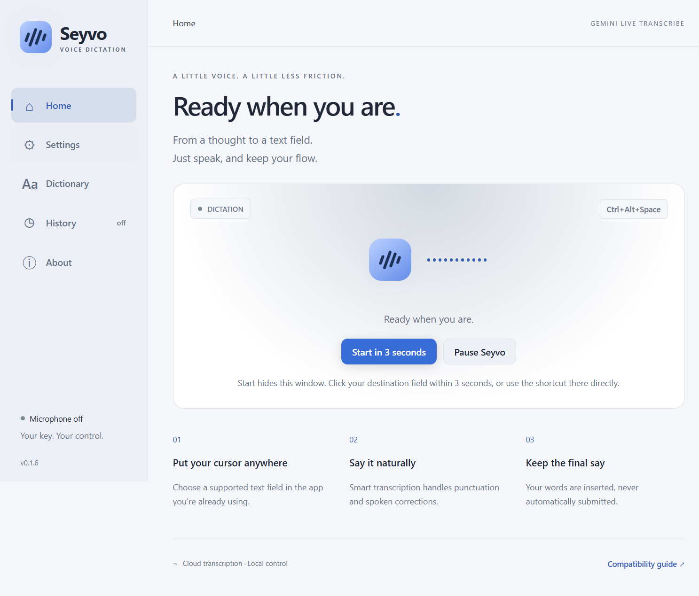
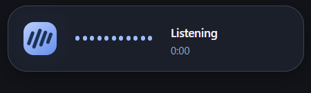

# Seyvo

**Speak. Refine. Paste.**

A Windows voice-dictation utility with your own Google Gemini API key. Use a global shortcut, speak naturally, and insert finalized text into a supported application without submitting it.

**0.1.6 validation build:** shortcut saves now show confirmation, and the next dictation starts fresh without dismissing old results. The installed app passed two consecutive generated-speech sessions through real Google and native Windows insertion, 51 unit/integration tests, 11 Electron scenarios and Windows CI. Physical microphone discovery/selection/open/stop also passed; the user reported successful human dictation separately. The installer is unsigned, and wider acceptance remains open. See the [release record](tests/manual-windows-qa.md).

[Download the Windows x64 installer](https://github.com/tirthankardgen-cell/Seyvo/releases/download/v0.1.6/Seyvo-0.1.6-windows-x64-setup.exe) · [SHA256 checksums](https://github.com/tirthankardgen-cell/Seyvo/releases/download/v0.1.6/SHA256SUMS.txt) · [Release notes, SBOM and licenses](https://github.com/tirthankardgen-cell/Seyvo/releases/tag/v0.1.6)

Install for your Windows account and follow the setup steps below. **Create a desktop shortcut** and **Run Seyvo** are checked by default; either can be unchecked. Clicking Finish opens Seyvo with the microphone off. This is an evaluation prerelease; it is not a signed, stable commercial release.



## What is implemented

- Smart or Verbatim Gemini Live Transcribe, automatic language recognition and vocabulary hints.
- Toggle shortcut with conflict reporting, real microphone level bubble, tray, pause, close-to-tray and installed startup preference.
- Original-field verification, Unicode-safe clipboard insertion with conditional restoration, direct single-line Unicode option and recoverable output when uncertain.
- Encrypted API key storage, local dictionary import/export, encrypted opt-in history and no audio files.
- Sandboxed Electron UI, bounded streaming, cancellation and privacy-conscious diagnostics.
- Optional sound cues, coding vocabulary, three bubble sizes, top/bottom/near-caret/custom placement, dictionary editing and About build information.

Seyvo has no subscription, account, telemetry backend or proprietary transcription proxy. **Google API charges, quotas, account geography and [data terms](https://ai.google.dev/gemini-api/terms) apply.** Audio goes to Google during dictation. This is not offline transcription. See [pricing](https://ai.google.dev/gemini-api/docs/pricing) and [privacy](PRIVACY.md).

## Build and run

Windows x64, Node 26.13.0 LTS (26.x), npm and the Windows .NET Framework C# compiler are required.

```powershell
npm ci
npm run dev
npm run check
npm run test:e2e
npm run dist:win
```

`dist:win` builds a per-user NSIS installer; see [release procedure](docs/release-checklist.md) for signing, install validation, checksums and real acceptance. Current versions are pinned in package.json and package-lock.json. The development test suite does not require a real key; live acceptance does.

## Use

1. Launch Seyvo. Get your own key from [Google AI Studio](https://aistudio.google.com/apikey), then **Save & test**. This verifies access to the exact transcription model without opening your microphone.
2. With Windows default selected, run **Test microphone** to discover inputs. Stop the test, choose your preferred microphone and test it locally. Configure a safe shortcut; default is **Ctrl + Shift + Space**.
3. Put the caret in a supported field in another application. Press the shortcut, speak, and press it again to finish. Escape cancels.
4. Check the target. If input was blocked or cannot be confirmed, open Seyvo from the tray to copy or retry. Check for existing text before retrying. Seyvo never sends Enter.
5. Press the shortcut again for a fresh dictation. It replaces the last in-memory result without replaying it. Copy any unsuccessful result first if you need to keep it; history stays off unless enabled.

Closing the window keeps the tray app running by default; choose **Quit Seyvo** to exit. History is off until enabled. Manual updates use the real GitHub Releases page; no updates are installed automatically.




## Compatibility and limitations

Initial development targets Windows 11 x64; the full [Windows matrix](tests/manual-windows-qa.md) records what was actually tested. Windows 10 support requires runtime and installation validation. ARM64 and push-to-talk are not shipped. No guarantee for administrator apps, password/read-only fields, secure desktops, remote sessions, terminals or custom editors. Insertion cannot universally be acknowledged by other apps, so Seyvo keeps the transcript available until the next dictation, Dismiss or exit.

Installed single-line Unicode input has also passed in Edge, Word, VS Code and the logged-out ChatGPT web composer. The [target acceptance record](docs/target-acceptance-0.1.4.md) lists the exact versions/configurations, unsafe-target refusals and remaining clipboard/variant checks.

Direct Unicode input is refused for Notepad because the tested Windows 11 version changed the fixture text. The refusal leaves the field unchanged. Clipboard mode there remains a separate acceptance item; inspect any result when choosing paste or Copy.

Clipboard paste can expose temporary text to Windows clipboard history or other apps. Unsupported clipboard formats cause safe refusal. Same-user malware may access secrets protected for that Windows account. See [support](docs/support-and-limitations.md), [security](SECURITY.md), [architecture](docs/architecture.md) and [threat model](docs/privacy-threat-model.md).

## Commercial use and project governance

[MIT](LICENSE) permits commercial use, modification and distribution with notice preservation. Google service terms are separate. Seyvo is independent and not affiliated with Google or Wispr Flow. It is an open-source alternative workflow, with original artwork and no copied competitor assets. The working name still needs [trademark clearance](docs/naming-and-trademark-clearance.md) before commercial launch. No support SLA is offered.

See [contributing](CONTRIBUTING.md), [changelog](CHANGELOG.md), [third-party notices](THIRD_PARTY_NOTICES.md) and [release checklist](docs/release-checklist.md). Repository screenshots are captured from the actual Windows application.

The [commercial launch notes](docs/commercial-readiness.md) separate MIT reuse rights from support, signing, provider terms and trademark decisions.

The [requirement evidence ledger](docs/requirements-evidence.md) maps the supplied specification to code, tests, observations and remaining acceptance.

The [0.1.4 security review and remediation](docs/security-review-0.1.4.md) records the fixed cancellation race. [Packaged performance measurements](docs/performance.md) document the method and its limits.
