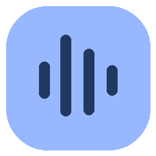

<div align="center">



# Seyvo

### Speak. Refine. Paste.

Open-source voice dictation for Windows.<br />
Your Gemini key. Your applications. No Seyvo subscription.

[](https://github.com/tirthankardgen-cell/Seyvo/releases/download/v0.1.7/Seyvo-0.1.7-windows-x64-setup.exe)
[](LICENSE)
[](https://github.com/tirthankardgen-cell/Seyvo/releases/tag/v0.1.7)

[Get started](#get-started) · [Features](#built-for-your-workflow) · [Privacy](#your-key-your-data) · [Develop](#build-and-contribute) · [Documentation](#documentation)

</div>

---

Seyvo lets you dictate into a supported Windows application with a global shortcut. Speak naturally, finish your dictation, and insert the finalized text at your original target—without automatically sending the message. It is a free, MIT-licensed, independently developed alternative to the Wispr Flow workflow, open to personal use, commercial use and community contributions.

<p align="center">
  
  <br />
  <sub>The actual installed application. Microphone off until you activate it.</sub>
</p>

> [!IMPORTANT]
> **The app is free; provider usage may cost money.** Bring your own Google Gemini API key. Google's charges, quotas, availability and data terms apply. Audio goes directly to Google during dictation; this is not offline transcription. Sessions have configurable duration limits. [Pricing](https://ai.google.dev/gemini-api/docs/pricing) · [FAQ](docs/faq.md)

## Get started

| 1 · Install | 2 · Connect | 3 · Dictate |
| :--- | :--- | :--- |
| Download the **Windows x64 installer** and install for your account. | Get your key from **[Google AI Studio](https://aistudio.google.com/apikey)**, then select **Save & test** in Seyvo. | Focus a supported text field. Press your shortcut to start, speak, and press it again to finish. |

**[Download v0.1.7](https://github.com/tirthankardgen-cell/Seyvo/releases/download/v0.1.7/Seyvo-0.1.7-windows-x64-setup.exe)** · [Verify SHA256](https://github.com/tirthankardgen-cell/Seyvo/releases/download/v0.1.7/SHA256SUMS.txt) · [Release notes, SBOM and licenses](https://github.com/tirthankardgen-cell/Seyvo/releases/tag/v0.1.7)

After saving your key, run **Test microphone**, stop the test, and select your preferred device. Configure your shortcut; the default is **Ctrl + Shift + Space**. **Escape** cancels dictation. Inspect the result before sending it or retrying insertion.

<details>
<summary><strong>Installation and everyday controls</strong></summary>

- **Create a desktop shortcut** and **Run Seyvo** are checked in the installer by default; either can be unchecked. Finish opens the app with the microphone off.
- Closing the window keeps Seyvo in the tray by default. Select **Quit Seyvo** to exit.
- If insertion is blocked or uncertain, open Seyvo to copy or recover the result. Check the target first to avoid duplicates.
- Starting a new dictation replaces the previous in-memory result. Copy any unsuccessful result you want to keep before starting again.
- History is off by default. Updates are manual through GitHub Releases; nothing is automatically installed.

</details>

> [!NOTE]
> **Code signing is pending.** The SignPath Foundation application has been submitted and acknowledged; review and approval are pending. Current installers are **unsigned evaluation prereleases**. No SignPath sponsorship or signed release is claimed. [Code signing policy](docs/code-signing.md)

## Built for your workflow

| Capability | What you get |
| :--- | :--- |
| **Natural dictation** | Smart or Verbatim Gemini transcription, automatic language recognition and vocabulary hints. |
| **Shortcut control** | Global toggle shortcut, conflict feedback, tray controls and a visible microphone level bubble. |
| **Careful insertion** | Original-target checks, conditional clipboard restoration, direct single-line Unicode input and recovery when insertion is uncertain. No auto-submit. |
| **Personal vocabulary** | Dictionary editing, import/export and coding vocabulary support. |
| **Desktop preferences** | Themes, optional sound cues, bubble sizes and placement, plus a Windows sign-in startup preference. |
| **Local control** | Encrypted key storage, optional encrypted history, explicit microphone activation and no saved audio files. |

<p align="center">
  
  <br />
  <sub>A compact microphone bubble keeps the dictation state visible.</sub>
</p>

<details>
<summary><strong>See the onboarding screen</strong></summary>


</details>

## Your key, your data

**No Seyvo account, subscription, telemetry backend or proprietary transcription proxy.** You supply your own key, and the installed app connects directly to Google while you dictate.

| Area | Behavior |
| :--- | :--- |
| Microphone | Opens on explicit activation. Local microphone testing is available before dictation. |
| Audio | Streamed to Google during dictation; no audio files saved by Seyvo. Google's [data terms](https://ai.google.dev/gemini-api/terms) apply. |
| API key | Encrypted locally using Windows protection. Same-user malware and OS compromise remain outside that protection boundary. |
| History | Optional, encrypted and off by default. |
| Clipboard | Restoration is conditional on unchanged clipboard state. Temporary text requests exclusion from Windows history/cloud sync; other clipboard readers may still observe it. |

Read the **[privacy policy](PRIVACY.md)**, [security policy](SECURITY.md) and [threat model](docs/privacy-threat-model.md) for the complete boundaries.

## Release and compatibility

**Current download: v0.1.7 · Windows x64 · unsigned prerelease.** This release improves screenshot/browser clipboard restoration, the transparent microphone bubble and Windows sign-in startup behavior.

| Area | Recorded status |
| :--- | :--- |
| Initial platform | Windows 11 x64. Windows 10 requires further runtime and installation validation. ARM64, macOS and Linux application support are not shipped. |
| Windows acceptance | Installed human English, Hindi and Hinglish checks passed with exact paste and clipboard restoration. Multilingual multiline paste was also checked in Edge, Word and VS Code. |
| Automated coverage | Current source records 55 automated tests and 11 Electron scenarios. Mocked tests, real provider observations and installed-app checks are documented separately. |
| Signing | SignPath Foundation review pending; current downloads are unsigned. |
| Further acceptance | Clean-machine, physical and accessibility coverage remain open, alongside an intermittent shutdown-test timeout. |

[Windows QA record](tests/manual-windows-qa.md) · [0.1.7 target acceptance](docs/target-acceptance-0.1.7.md) · [Security review](docs/security-review-0.1.7.md) · [Performance measurements](docs/performance.md)

<details>
<summary><strong>Supported boundaries and insertion limitations</strong></summary>

Seyvo cannot guarantee insertion into administrator apps, password/read-only fields, secure desktops, remote sessions, terminals or custom editors. Another application's acceptance cannot universally be confirmed. The last result stays available until the next dictation, Dismiss or exit. Push-to-talk is not shipped.

Direct Unicode input is refused for Notepad because the tested Windows 11 version changed the fixture text. Clipboard paste passed with Hindi, emoji and multiple paragraphs in an owned Notepad document. Inspect results before retrying.

Supported clipboard images, text/HTML, Chromium metadata and privacy flags are restored when unchanged. Unsupported or unavailable formats and snapshots over 64 MiB cause safe refusal.

See [support and limitations](docs/support-and-limitations.md) for details.

</details>

## Build and contribute

Contributions are welcome: bug fixes, tests, documentation, accessibility improvements and Windows compatibility reports all help.

**Prerequisites:** Windows x64, Node **26.13.0 or compatible newer 26.x**, npm, and the Windows .NET Framework C# compiler. Dependency versions are pinned in the committed lockfile.

```powershell
# Install locked dependencies
npm ci

# Start development
npm run dev
```

| Command | Purpose |
| :--- | :--- |
| `npm run check` | Type checking, linting, unit/integration tests and production build. |
| `npm run test:e2e` | Electron UI scenarios. |
| `npm run dist:win` | Build the per-user Windows x64 NSIS installer. |

Development tests do not require a real Google key; live provider acceptance does. Windows native builds and full application validation require Windows. Read the [contribution guide](CONTRIBUTING.md), [agent instructions](AGENTS.md) and [release procedure](docs/release-checklist.md) before making changes.

**[Report a bug](https://github.com/tirthankardgen-cell/Seyvo/issues/new?template=bug.yml)** · **[Suggest a feature](https://github.com/tirthankardgen-cell/Seyvo/issues/new?template=feature.yml)** · **[Contribute](CONTRIBUTING.md)**

Include your app version, Windows build and reproducible steps using synthetic examples. Keep API keys, private audio, transcripts and clipboard contents out of reports. Report vulnerabilities through [SECURITY.md](SECURITY.md). Participation follows our [Code of Conduct](CODE_OF_CONDUCT.md); community support has no response-time SLA.

## Documentation

| For users | For contributors | For distributors |
| :--- | :--- | :--- |
| [FAQ](docs/faq.md) | [Architecture](docs/architecture.md) | [Commercial readiness](docs/commercial-readiness.md) |
| [Privacy policy](PRIVACY.md) | [Contribution guide](CONTRIBUTING.md) | [Code signing](docs/code-signing.md) |
| [Support and limitations](docs/support-and-limitations.md) | [Requirements and evidence](docs/requirements-evidence.md) | [Release checklist](docs/release-checklist.md) |
| [Changelog](CHANGELOG.md) | [Security review](docs/security-review-0.1.7.md) | [Third-party notices](THIRD_PARTY_NOTICES.md) |

## License and commercial use

**[MIT licensed](LICENSE). Free to download. Commercial use permitted.** You may use Seyvo at work, modify it, redistribute it or sell copies while preserving the required copyright and license notice. Bundled dependencies retain their own licenses; Google service terms remain separate.

Seyvo is independently developed and is not affiliated with Google or Wispr Flow. The working name still requires [trademark clearance](docs/naming-and-trademark-clearance.md). Review [commercial readiness](docs/commercial-readiness.md) before offering supported deployments; an open-source license does not establish production certification.

---

<div align="center">

<strong>Seyvo · Speak. Refine. Paste.</strong><br />
Built for Windows. Open for everyone to contribute.

[Download](https://github.com/tirthankardgen-cell/Seyvo/releases/tag/v0.1.7) · [Source](https://github.com/tirthankardgen-cell/Seyvo) · [Issues](https://github.com/tirthankardgen-cell/Seyvo/issues)

</div>
