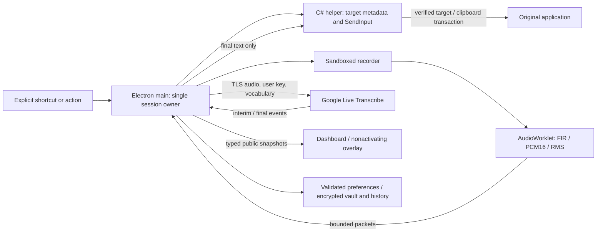

# Architecture

Seyvo is a Windows x64 Electron application with React views and a narrowly scoped .NET Framework native helper. `src/shared/brand.ts` centralizes user-facing identity/links; installer appId and metadata are explicit in `electron-builder.yml`.

## Ownership and trust

`SessionCoordinator` owns one immutable session ID, cancellation token, captured target, settings snapshot, provider and timer. Renderer components consume snapshots and issue typed actions; they never own recording state. Settings changes are serialized and blocked during capture. The recorder's bridge contains only audio packet/event methods. Main validates window, main frame, exact URL, schema and bounds on every IPC call. The overlay can read state but cannot perform dashboard mutations. Saved keys and native handles never cross the UI bridge.

`Windows` restricts permission to audio in the recorder during an authorized capture. No remote page is loaded into an app window. Browser opens use named fixed links. The hidden recorder page preloads without requesting microphone access and remains loaded after successful cleanup; failed recorders are destroyed. Its AudioWorklet low-pass filters, downmixes and converts input to 16 kHz PCM16; max four IPC packets await acknowledgement. Provider upload stops if socket buffering exceeds 64 KB. No audio is persisted.

Microphone discovery happens in the authorized recorder after it obtains a stream. It reports at most 32 bounded input descriptors through validated, session-scoped IPC. Main keeps the list in memory for the dashboard; the overlay receives no device descriptors. Only the chosen device ID is persisted as a preference. The dashboard cannot capture audio, even after a recorder has received permission. Device-change listeners exist only during capture. Permission denial and unavailable-device errors destroy the recorder window, leave the microphone off and show a dismissible error on every dashboard page.

## Provider contract

`GeminiLive` implements the official WebSocket setup/realtimeInput protocol, using installed `@google/genai` types for transcription messages/configuration. The SDK 3.0.0 `Session.conn` exposes only connect/send/close, and pending `live.connect()` does not expose a cancellation handle. The verified protocol adapter was selected for deterministic terminate, handshake timeout, max message payload and bufferedAmount checks. It uses only Google's fixed endpoint and the user's key; no proxy.

Audio begins only after `setupComplete` and explicit `begin()`. `StandbyConnection` owns one setup-only idle socket, then transfers it to the session coordinator. Idle connections send neither audio nor activity boundaries; unsolicited transcripts are ignored. Each completed/cancelled activity closes its socket and drops its assembler. Background preparation resumes only when enabled and no provider failure has stopped automatic retries. Key tests and both foreground/background setup share a rolling four-attempts-per-minute limit. Idle renewal reserves the entire configured maximum dictation plus 30 seconds within the ten-minute provider limit and is capped at 45 seconds to precede Google's observed approximately 60-second silent-session deadline. Renewal closes the old socket before setup; a shortcut during renewal waits for that setup. WebSocket control pings every 20 seconds detect transport failure without model input. Temporary idle failures get at most three retries after 30/60/120 seconds; quota, credential, model and policy failures stop retries. Pause, sleep, lock, key removal and quit stop standby. This intentionally replaces the original no-idle-network performance target, as requested by the owner. Interim text replaces preview, never enters insertion. Final segments deduplicate by provider offsets when present; without offsets, matching text at the same audio-sequence position is a duplicate. Identical speech at different positions is retained. There is no guaranteed globally unique provider segment identifier; tests and release review must monitor protocol changes.

Each explicit dictation uses Google's documented manual activity boundaries: automatic VAD is disabled, setup completion can precede the shortcut, explicit activation sends activityStart, and stop drains recorder packets before activityEnd. This avoids depending on a silence boundary that might occur before the user stops. The adapter handles generationComplete (observed in the live transcription service), turnComplete and optional transcription.finished, followed by a quiet drain interval. A ten-second timeout retains only committed segments and never auto-inserts partial output. A five-minute default session cap remains below Google's documented ten-minute ceiling (configuration capped at nine minutes). Errors are reduced to fixed messages, not logged raw. No automatic paid retry or second rewrite call.

## Native integration and insertion

Optional single-key mode adds a fixed `watchShortcut` command, limited to enabling/disabling Right Ctrl. A dedicated native message-loop thread filters Windows low-level keyboard events to Right Ctrl down/up plus an interruption marker when another key forms a chord. It never suppresses keys or emits/logs other key identities. Main validates event shape/generation and owns the three-second hold timer, repeat suppression and hold/toggle session actions. Release while connecting cancels pending setup; stop waits for Ctrl release so insertion does not fight a held modifier. Pause, rebind, lock, sleep and shutdown reset gestures. Listener loss cancels recording and restores the saved combination if registration succeeds. Existing profiles default to their saved combination. Bare Fn has no standard Windows virtual key and is explicitly unavailable.

The helper runs as the same user, communicates through inherited pipes, and supports ping/capture/insert/clear plus three named sound cues. It retains a single opaque target token. Capture uses foreground HWND/PID/thread/process start time, focused child, UI Automation runtime identity, optional selection endpoints and caret geometry. Only editable Edit/Document controls with writable ValuePattern or TextPattern properties qualify. It does not retrieve field text. Every insertion verifies the original foreground field and position. It does not force-focus unrelated windows. Temporary process handles are disposed after identity checks.

Opt-in start/stop/error cues are original synthesized PCM tones. Cached SoundPlayer instances use asynchronous Windows mixer playback; the app does not alter system volume or mute. Cue failure does not interrupt dictation. The explicit preview action reports playback errors. The coding preset is merged with user vocabulary only when enabled, deduplicated and capped at 1,000 entries with user terms first.

Clipboard insertion snapshots supported HGLOBAL formats (text/Unicode/locale/DIB/DIBV5/HTML/RTF/PNG, opaque .NET bitmap payloads and Windows privacy flags) plus an owned clone of CF_BITMAP, within a combined 64 MiB limit. DIBV5 supersedes synthesized DIB. COM DataObject/Ole Private Data bookkeeping is not replayed after ownership changes; concrete supported content must exist. Unsupported content causes refusal before mutation. Snapshot disposal clears copied byte buffers and releases any bitmap not transferred to Windows. Temporary transcript data disables Windows history/cloud eligibility. It samples the sequence after CloseClipboard publishes the new data, then checks clipboard owner, sequence, modifiers and target before Ctrl+V. Restoration after 800 ms requires both owner and sequence still to match; a concurrent copy is preserved. Direct Unicode input is limited to single-line text up to 5,000 UTF-16 code units and never synthesizes Enter. A native request has a five-second timeout; the helper is terminated on hangs, invalidating target tokens.

The first helper handshake has a 15-second allowance for cold .NET/Windows initialization; capture and insertion keep the five-second operation timeout. No universal acknowledgment exists for third-party paste. After a completed native input attempt, the app reports “Text sent,” asks the user to check the target before retrying and returns to idle. The last text remains available in memory. A new explicit dictation replaces it without replaying insertion, copying old text or enabling history; it captures a new target and caret. Failed or incomplete output likewise remains available until the next dictation, Dismiss or exit. Connecting, recording, finalization and insertion cannot overlap.

Direct Unicode is explicitly refused for `notepad.exe`: the Windows 11 target transformed the acceptance fixture. The guard runs before SendInput, leaves the target unchanged and returns an actionable recovery message. No automatic method switch or keyboard-layout change is made. The 0.1.7 clipboard path passed Hindi, emoji and multiline text in an owned Windows Notepad document, with paragraph-preserving line-ending normalization in the UI Automation comparison.

Bubble positioning uses the caret rectangle captured at activation when available, otherwise the original window's monitor. The native helper converts a Win32 caret rectangle to screen coordinates, with a narrow UI Automation rectangle fallback; neither path calls GetText. Main converts physical geometry to Electron logical pixels and keeps it out of renderer snapshots. Near-caret placement prefers below, then above; stale/unavailable geometry falls back to the bottom of the work area. Custom X/Y percentages map to bounded positions on the active monitor. The explicit three-second preview opens no recorder and its expiry cannot hide a newer session's bubble.

## Lifecycle and storage

Single-instance lock, tray persistence, opt-in installed startup, pause/unregister, close-to-tray preference, explicit quit and suspend/lock cancellation. Cancellation invalidates session before awaited cleanup. Recorder permission and tracks close; sockets terminate. Disk writes flush a same-directory temporary file and rename it. Redirected profiles that return EXDEV use a checksummed, flushed `.pending` journal before copying the destination. Readers prefer a complete journal; interrupted journals cannot replace the last durable value. The next write finishes recovery before replacing a committed journal. Key/history bytes are encrypted before either path, and removal deletes both destination and journal. Settings schema version 1 restores defaults with a backup for corruption. Async Windows encryption protects key/history; files are not portable across Windows accounts. History is bounded by age/count and disabled by default.

Finalized delivery retains a separate cancellable identity while provider/microphone cleanup and history persistence complete. This keeps the operation busy and Escape available through storage waits. Cancel, pause, lock and shutdown revoke delivery; stale storage completion or failure cannot deliver text or overwrite a later session. The native insertion transaction, once dispatched, still settles before shutdown so clipboard restoration can finish.

Chromium text copies can include `Chromium internal source URL` and `Chromium internal source RFH token`. These exact named HGLOBAL payloads are preserved as bounded opaque bytes alongside the original text/HTML, without parsing, following URLs or resolving tokens. They are not attached to Seyvo's temporary transcript. Chromium's Windows implementation uses HGLOBAL data for source URL metadata: https://github.com/chromium/chromium/blob/main/ui/base/clipboard/clipboard_win.cc. Unknown registered formats still refuse before mutation.
